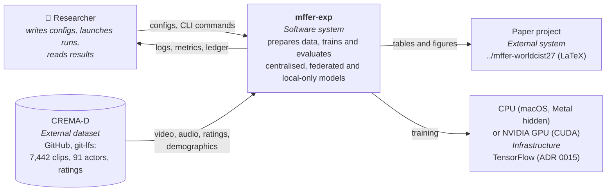
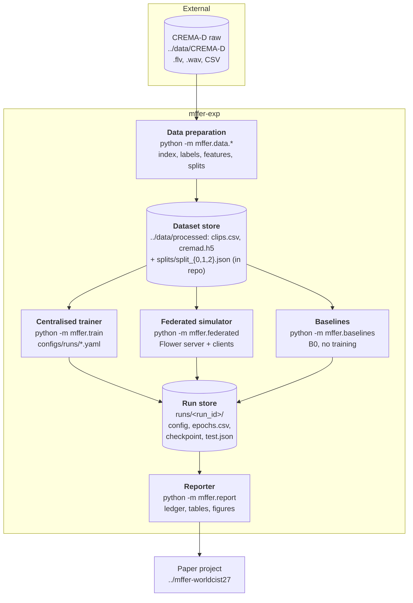
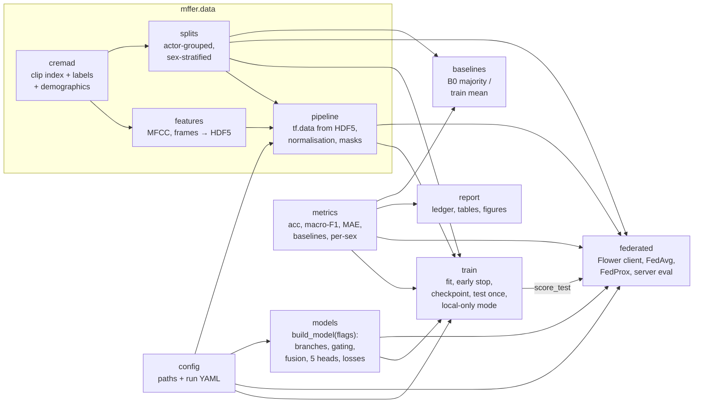

# mffer-exp — experiments for the WorldCIST'27 paper

Code for every experiment in the paper *Federated Multimodal Multi-Task Emotion Recognition for
Emotion-Aware Retail Assistants*. The paper's LaTeX lives next door in `../mffer-worldcist27/`; the
experiment plan is `../mffer-worldcist27/EXPERIMENT-PLAN.md`.

## Purpose

A retail kiosk assistant that reacts to a customer's emotional state must learn from face and voice data
that should stay on the kiosk. This repository trains and evaluates the emotion component of that
assistant:

- a **multi-task multimodal model** that predicts displayed emotion, perceived emotion, displayed valence
  and emotion intensity from audio (MFCCs), video frames and, optionally, text and demographics;
- trained **centrally** and with **federated learning** (Flower, FedAvg), and per client alone
  (local-only), on **CREMA-D**;
- under an **actor-independent protocol**: train, validation and test actors are disjoint; three
  different actor splits for mean ± sd; test is scored once, at the epoch (or round) chosen on validation.

Every number in the paper must be traceable to one run directory produced by this code.

Non-goals: the recommender, the chatbot and real kiosk deployment (architecture only in the paper);
privacy mechanisms beyond keeping raw data on the client (no differential privacy, no secure aggregation).

## Reproduce on a new machine

Needs conda, git and git-lfs, and ffmpeg (macOS: `brew install git-lfs ffmpeg`). About 20 GB of disk.

```bash
git clone https://github.com/n0th1ng999/mffer-exp.git
mkdir data && cd data                                         # sibling of mffer-exp (see configs/paths.yaml)
git lfs install
git clone https://github.com/CheyneyComputerScience/CREMA-D.git
git -C CREMA-D checkout 1658cd342dff90010aa843eaeebd53610a08b1dc   # the version used in the paper
cd ../mffer-exp
conda env create -f environment.yml        # macOS: TF 2.19 + Metal; Linux: TF 2.19 + CUDA; Windows: use WSL2
conda activate mffer
python scripts/smoke_test.py               # training device, M1/M3 train a few steps, Flower runs 2 rounds
python -m mffer.data.cremad --summary      # checks the CREMA-D commit, builds clips.csv
python -m mffer.data.features              # MFCCs + 10 frames per clip -> cremad.h5 (~1–30 min, ~11 GB)
python -m pytest -q tests                  # invariants: splits, masks, normalisation, metrics
```

### Linux or Windows (WSL2) with an NVIDIA GPU

Everything above applies; these steps come first. On Windows all of it runs inside WSL2 (Ubuntu), never in
PowerShell. Not yet tried on such a machine: the first run there is the check at the end of this section.

```bash
# Windows only, in an admin PowerShell: install WSL2 + Ubuntu, then reboot and open "Ubuntu"
wsl --install -d Ubuntu
```

1. **NVIDIA driver:** the normal Windows (or Linux) driver for the card. Inside WSL2 install **no** driver and
   no CUDA toolkit: `tensorflow[and-cuda]` in `environment.yml` brings its own CUDA libraries. `nvidia-smi`
   inside Ubuntu must list the card.
2. **Tools:** `sudo apt update && sudo apt install -y git git-lfs ffmpeg`, and Miniforge for conda
   (`curl -LO https://github.com/conda-forge/miniforge/releases/latest/download/Miniforge3-Linux-x86_64.sh &&
   bash Miniforge3-Linux-x86_64.sh`). For commits: `pipx install pre-commit` (see Development).
3. **Where the data lives:** clone into the Linux home (`~/mffer/...`), not `/mnt/c/...`; reading the 11 GB
   HDF5 across the Windows boundary is many times slower. Either rebuild the features with the commands above
   or copy `../data/processed` (`clips.csv`, `cremad.h5`) from another machine.
4. **Check:** `python scripts/smoke_test.py` must print `training device: cuda ['NVIDIA GeForce RTX ...']`.
   On Linux, `requirements-macos-arm64.lock` does not apply; conda resolves `environment.yml` (TF 2.19.x,
   Flower 1.43.x) and each run records the exact TensorFlow version in `meta.json`.

**First job on a CUDA machine (before any paper run):** check that CUDA trains like the CPU, the way the
Metal problem was found (ADR 0015). Same seed, same 12 epochs, nothing written to `runs/`:

```bash
python scripts/lab_stability.py --preset audio_only --split 0 --epochs 12 --cpu --label cpu
python scripts/lab_stability.py --preset audio_only --split 0 --epochs 12 --label cuda
```

The two curves should stay within about a point of each other and the loss must keep falling. If CUDA
diverges like Metal did, train there with `MFFER_CPU=1` (every command; the reporter accepts CPU runs from
any machine). Record the outcome in ADR 0015.

The actor splits are **not** regenerated: they are versioned in `splits/` and every machine uses the same
files (`python -m mffer.data.splits` refuses to overwrite them).

**What will and won't match.** Labels, masks, splits, features and seeds are identical on every machine.
Training runs on the CPU ([ADR 0001](docs/adr/0001-cpu-only-training.md)); multithreaded CPU kernels are
not guaranteed to sum in the same order on every machine, so a rerun can differ by a few tenths of a point
per run; compare against the mean ± sd over the three splits, not single runs. Times per epoch depend on the hardware recorded in each run's `meta.json`. Exact package versions of
the paper's runs: `requirements-macos-arm64.lock`.

## Everyday commands

```bash
conda activate mffer
./run c1 0                                                # one centralised run (see How to run)
python scripts/timing_pilot.py --preset m3                # time per step on this machine
python3 scripts/render_todo.py                            # refresh todo.html after editing TODO.md
open results.html                                         # scores of every run (./run refreshes it)
```

Paths are set once in `configs/paths.yaml` (dataset at `../data/CREMA-D`, outputs in `runs/`).

## Repository layout

| Path | What | Status |
|---|---|---|
| `scripts/render_results.py` | `results.html`: scores per experiment (mean ± sd) and per run; click a run for interactive learning curves (hover, drag to zoom, expand, log scale), confusion matrices, per-class and per-sex scores, every epoch. Metrics in priority order; which runs count comes from `mffer.report`, so the page and the paper tables agree. Run by `./run` after each run | done |
| `run` | One command per experiment: `./run c1`, `./run c2 0`, `./run resume …` (see How to run) | done |
| `environment.yml` | Conda environment (macOS Metal / Linux CUDA) | done |
| `requirements-macos-arm64.lock` | Exact package versions of the paper's runs | done |
| `splits/` | The three frozen actor splits (versioned; never regenerated) | done |
| `configs/paths.yaml` | Dataset and output paths | done |
| `configs/runs/*.yaml` | One file per configuration: C1, C2, U1, U2, D1–D4, F1 (`f1_iid`), F2 (`f2_actor`), F3 (`f3_actor4`), F4 (`f4_fedprox`), L1 (`l1_local`) | done |
| `mffer/config.py` | Load paths and run configs | done |
| `mffer/data/cremad.py` | Index CREMA-D: one row per clip with actor, sentence, labels, demographics | done (labels frozen 18 Nov) |
| `mffer/data/splits.py` | Actor-grouped, sex-stratified train/val/test splits, saved as JSON | done |
| `mffer/data/features.py` | MFCC and frame extraction → HDF5 | done |
| `mffer/data/pipeline.py` | `tf.data` input pipeline from HDF5 + split ([design](docs/pipeline-design.md)) | done |
| `tests/` | Invariant tests for splits, pipeline, metrics, reporter and FedProx: `python -m pytest -q tests` | done (24 tests) |
| `scripts/lab_stability.py` | The lab experiment behind CPU-only training: one configuration under variants (CPU/GPU, lr, clipnorm, no BN), per-epoch curves, writes nothing to `runs/` | done |
| `docs/adr/` | Architecture Decision Records: one file per protocol or design decision ([index](docs/adr/README.md)) | done (15 records) |
| `pyproject.toml`, `.pre-commit-config.yaml` | Package metadata, ruff lint rules, pytest settings; commit/push hooks (see Development) | done |
| `scripts/timing_pilot.py` | Time per training step and per batch read on real data | done |
| `mffer/models.py` | Model builder: M1, M3 and the ladder variants from config flags | done |
| `mffer/train.py` | Centralised training, early stopping, checkpoints, resume, test once; local-only mode (`--client k`) | done; ran end to end (C1, U1 ×3) |
| `mffer/federated.py` | Flower simulation (FL-IID, FL-non-IID): FedAvg, val per round, early stopping, resume, test once | done 19 Nov; checked on small models |
| `mffer/metrics.py` | Accuracy, macro-F1, MAE, per-sex breakdown, IEO intensity-ordering check, from `predictions.csv` | done |
| `mffer/baselines.py` | B0: majority class / train mean per head, written as normal run directories | done 19 Nov |
| `mffer/report.py` | Results ledger, paper tables (`generated/tab-*.tex`) and learning-curve figure, from run directories only | done 19 Nov |
| `scripts/smoke_test.py` | Environment check on random tensors: training device, M1/M3 steps, Flower | done |
| `mffer/device.py` | Training-device policy: CPU on macOS (Metal hidden), CUDA on Linux/WSL2, `MFFER_CPU=1` forces the CPU | done 19 Nov; CUDA path untested |
| `notebooks/eda.ipynb` | Exploratory analysis of CREMA-D: labels, masks, splits, baselines (kernel *Python (mffer)*) | done |
| `TODO.md`, `todo.html` | Task list (source) and its browser view; refresh with `python3 scripts/render_todo.py` | done |
| `runs/` | One directory per run (git-ignored) | — |

## Experiments

Every experiment answers one question, and every one is scored the same way: on the **test actors of the
same split**, once, at the epoch (or round) chosen on validation. "×3" means the three frozen actor splits
(`splits/split_{0,1,2}.json`), reported as mean ± sd.

### Shared protocol

| Item | Value (identical for every experiment) |
|---|---|
| Inputs | Audio: 13 MFCCs × 100 frames (4 s), train-split normalisation. Video: 10 frames, 224×224 RGB. Text: one-hot sentence ID. Demographics: scaled age + sex |
| Outputs (5 heads) | Displayed emotion (6, softmax), perceived emotion (6, softmax), displayed valence (3, softmax), displayed intensity (sigmoid, MSE, IEO clips only), perceived intensity (sigmoid, MSE) |
| Loss weights | 1.0 for the three classification heads, 0.2 for each intensity head; masked heads divided by label coverage |
| Optimiser | Adam, learning rate 1e-4, batch 16, float32 |
| Device | **CPU on macOS, CUDA on an NVIDIA GPU** (`mffer/device.py`, [ADR 0015](docs/adr/0015-cuda-allowed-metal-not.md)). On the Metal GPU (tensorflow-metal 1.2.0, TF 2.18 and 2.19) the same code, data and seed diverge after 3–4 epochs while the CPU trains cleanly (`scripts/lab_stability.py`), so Metal is always hidden and its runs never count. `MFFER_CPU=1` forces the CPU anywhere. `meta.json` records `device` (cpu / cuda) and the GPU model; a run is resumed only on the device it started on, and every federated client must train on the run's device |
| Primary metric | **Valence macro-F1**, then displayed-intensity MAE, then perceived-intensity MAE ([ADR 0014](docs/adr/0014-primary-metric-valence-f1.md)). Macro, because always answering "negative" already scores 68% valence accuracy (macro-F1 0.27). Tables and pages list metrics in this order |
| Budget | At most 90 epochs (or rounds; raised from 30 on 18 Nov, when best epochs landed at 25–29); early stopping with patience 5 on **val valence macro-F1** (until 19 Nov: val displayed-emotion accuracy; runs selected that way are `invalid (old monitor)`) |
| Seed | Weight-initialisation seed = split id (overridable with `--seed`) |
| Metrics | Macro-F1 and accuracy per classification head; MAE per intensity head against the constant predictor; macro-F1 and accuracy by sex; IEO ordering check (perceived intensity rises LO → MD → HI); parameters, minutes per epoch, FL update size (parameters × 4 bytes) |
| Output | One run directory `runs/<config>-s<split>-<yyyymmdd-hhmm>/`: config, split, seed, git hash, hardware, `epochs.csv`, checkpoints, test predictions and metrics |

### Model building blocks

All models come from `build_model` in `mffer/models.py`; a configuration is a preset of flags, so two
configurations differ only by the flags they declare.

- **Audio encoder:** Conv1D(64, 5) + BatchNorm → global average pooling → Dense 64.
- **Simple visual encoder (M1):** per frame Conv2D(16, 3, stride 2) → MaxPool 4 → global average pooling;
  then LSTM(32) over the 10 frames.
- **Deep visual encoder:** per frame 3 × [Conv2D(32/64/128, 3) + BatchNorm + MaxPool 2] → global average
  pooling; then BiLSTM(64) → Dense 128.
- **Modality gating:** each encoding (audio, visual, and text when present) is multiplied by a learned
  scalar in (0, 1) computed from that encoding.
- **Text branch:** Dense 64 + Dropout 0.2 on the sentence one-hot; joins the acoustic group.
- **Demographics branch:** Dense 32 + Dropout 0.2 on age and sex; joins both groups.
- **Fusion:** *concatenation* of the audio and visual encodings, or, once text or demographics are present,
  *hierarchical* fusion: an acoustic group (audio + text + demographics) and a visual group (visual +
  demographics), each through Dense 128 + Dropout 0.3, then concatenated. With audio and video alone the
  hierarchical form reduces to concatenation, so it enters together with those modalities.
- **Shared trunk and heads:** Dense 256 + Dropout 0.4 → Dense 128 → the five heads.

### Baselines — what does the task give for free?

| ID | Experiment | Detail | Splits |
|---|---|---|---|
| **B0** | Majority class and constant predictor | No training, no inputs (not a learned model such as k-NN). For each classification head, predict the most frequent train-split class; for each intensity head, predict the train-split mean. Sets the floor every model must beat (e.g. split 0 test: valence macro-F1 27.1% at 68.3% accuracy, displayed-intensity MAE 0.222, perceived-intensity MAE 0.090, displayed emotion 17.1%). The perceived-intensity head is kept in the paper only if models beat its constant predictor | ×3 |
| **U1** | Audio-only | Audio encoder → shared trunk → heads (preset `audio_only`). How far the voice alone goes; cheap, since no video is read | ×3 |
| **U2** | Video-only | Simple visual encoder → shared trunk → heads (preset `video_only`). How far the face alone goes | ×3 |

### Centralised models — does multimodal multi-task learning work on unseen actors?

| ID | Experiment | Detail | Splits |
|---|---|---|---|
| **C1** | M1: audio-visual baseline | Audio encoder + simple visual encoder, concatenation fusion (preset `m1`). The reference audio-visual model | ×3 |
| **C2** | M3: full model | Audio encoder + deep visual encoder, gating, text and demographics, hierarchical fusion (preset `m3`). The model the paper proposes; also the model used for all federated experiments | ×3 |

### Design ladder — which design choice contributes what?

From M1 to M3 one change at a time, each step trained with the same budget, so a difference between two
neighbouring steps is attributable to that one change.

| ID | Step | Change from the previous step | Splits |
|---|---|---|---|
| **D1** | M1 + deeper visual encoder | Simple → deep visual encoder (preset `d1`) | 1 |
| **D2** | D1 + modality gating | Gates on the audio and visual encodings (preset `d2`) | 1 |
| **D3** | D2 + demographics | Adds age and sex, which switches fusion to hierarchical (preset `d3`) | 1 |
| **D4** | D2 + text | Adds the sentence ID to the acoustic group, hierarchical fusion, no demographics (preset `d4`). Text carries no emotional content in CREMA-D; this measures what the sentence identity alone adds | 1 |
| (C2) | D2 + text + demographics | The full M3, already run as C2 | — |

### Federated and local-only — what does keeping data on the kiosk cost?

All on the M3 model, the same test actors as C2, and equal compute: one round is one local epoch on every
client, i.e. one pass over all training data, so 90 rounds match 90 centralised epochs. The server scores
the global model on val after every round; test is scored once, at the val-selected round. Audio normalisation
statistics are computed per client (raw data never leaves it); the server pools the clients' summary
numbers (13 means, 13 stds, a count) exactly to score the global model. Each client also compensates loss weights with its own label
coverage. Clients keep no state between rounds: each round starts from the global weights with a fresh
Adam (standard FedAvg; centralised training keeps Adam's moments across epochs, so this is part of the
"cost of federation"). The global model starts from the same initial weights as C2 (same seed). Clients
run one at a time in one Flower simulation (`mffer/federated.py`); a round in which any client fails, or
sees a GPU, stops the run instead of averaging the survivors. Client k of F2 and local-only client k of L1
hold the same rows (`splits.client_rows`, seed = split id; tested).

| ID | Experiment | Detail | Splits |
|---|---|---|---|
| **F1** | FL-IID | 2 clients; training clips dealt round-robin within the train actors, so both clients see every actor. FedAvg weighted by client size. The gap to C2 is the cost of federation alone | ×3 |
| **F2** | FL-non-IID | 2 clients, each holding different train actors (the realistic kiosk case: each kiosk sees its own customers). The gap to F1 is the cost of heterogeneous clients | ×3 |
| **L1** | Local-only | Each F2 client trains alone on its own actors, no aggregation; each model scored on the same val and test actors. Shows whether federating beats not collaborating at all (two trainings per split, reported as the mean of the two clients). Same trainer as the centralised runs (`mffer.train --client k`), restricted to that client's rows | ×3 |
| **F3** | More clients | Like F2 with 4 actor-partitioned clients (about 16 train actors each): does the gap grow as each client holds fewer actors? | 1 |
| **F4** | FedProx | F2 with FedProx: each client adds (μ/2)·‖w − w_global‖² to its training loss, so it drifts less from the global model during its local epoch; aggregation stays FedAvg. μ = 0.01 (common default, not tuned). Tests whether a method designed for heterogeneous clients helps the kiosk case; with 2 clients and 1 local epoch drift is small, so a null result is likely and still reportable | 1 |

### Label variant

| ID | Experiment | Detail | Splits |
|---|---|---|---|
| **S1** | Soft perceived-emotion labels | C2 with the perceived-emotion head trained on the rating distribution instead of the majority vote (tied clips no longer masked) | 1 |

### How to run

From the repository root, one command per experiment, using the README IDs. No need to activate conda:
`./run` uses the `mffer` environment itself.

```bash
./run b0        # B0 majority class / constant predictor, splits 0, 1, 2 (seconds)
./run u1        # U1 audio-only, splits 0, 1, 2
./run u2        # U2 video-only, splits 0, 1, 2
./run c1        # C1 M1, splits 0, 1, 2 (up to ~1.2 h each on the CPU)
./run c2        # C2 M3, splits 0, 1, 2 (up to ~9.5 h each on the CPU; early stopping usually ends it sooner)
./run d1        # D1 (likewise d2, d3, d4), split 0 only
./run f1        # F1 FL-IID, splits 0, 1, 2 (M3; a round costs about one C2 epoch)
./run f2        # F2 FL-non-IID, splits 0, 1, 2
./run l1        # L1 local-only: clients 0 and 1 of every split (six trainings)
./run f3        # F3 FL-non-IID with 4 clients, split 0
./run f4        # F4 FedProx (F2 + proximal term, mu 0.01), split 0
```

After runs land, regenerate the paper's numbers (writes `../mffer-worldcist27/notes/results-ledger.md`,
`generated/tab-{main,ladder,federated,sex}.tex` and `generated/fig-curves.pdf`; only counted runs, i.e.
the latest finished CPU run per configuration and split):

```bash
conda run -n mffer python -m mffer.report
```

| Variant | Effect |
|---|---|
| `./run c2 0` | Only split 0 (any of 0, 1, 2; several allowed: `./run c2 1 2`) |
| `./run resume runs/<run-dir>` | Continue an interrupted run (centralised or federated) from its last epoch or round; a finished run is only re-scored |
| `./run l1 0` | L1 on split 0 only (both clients). One client: `python -m mffer.train configs/runs/l1_local.yaml --split 0 --client 1` |

Each run creates `runs/<config>-s<split>-<yyyymmdd-hhmm>/`, prints the test metrics at the end and saves
its terminal output to `runs/_logs/<id>-s<split>-<yyyymmdd-hhmm>.log`. Closing the terminal stops the run;
continue it with `./run resume`. (`./run` calls `python -m mffer.train <config> --split <n>`, which also
takes `--seed N` for seed-variance checks; paper runs use the default seed = split id.)

Not runnable yet (no code); the command goes here once it exists:

| ID | Missing piece |
|---|---|
| S1 | Soft perceived-emotion targets in `mffer.data` and a config |

### Implementation status

Updated by hand as runs land; the full task list with dates is `TODO.md`.

| ID | Code | Config | Runs done | Notes |
|---|---|---|---|---|
| B0 | ready (`mffer.baselines`, 19 Nov) | — | 3 / 3 | `runs/b0_majority-s{0,1,2}-20261119-*`: displayed 17.1%, perceived 26.9% ± 0.6, valence 68.3%, perceived-intensity MAE 0.088 ± 0.002, displayed-intensity MAE 0.222 |
| U1 | ready (`mffer.train`) | `u1_audio.yaml` | 0 / 3 | **Rerun needed**: epochs were picked on displayed-emotion accuracy (ADR 0014). Previous: CPU, 90-epoch limit, 18 Nov (`runs/u1_audio-s{0,1,2}-20261118-{2016,2016,2017}`): valence macro-F1 56.5% ± 0.6, test displayed acc 52.5% ± 0.5, perceived 52.7%, valence acc 72.8%, perceived-intensity MAE 0.083. Stopped by patience at epochs 30, 43, 33. 30-epoch and GPU runs superseded |
| U2 | ready | `u2_video.yaml` | 0 / 3 | |
| C1 | ready | `c1_m1.yaml` | 0 / 3 | **Rerun needed** (ADR 0014). Previous: CPU, 18 Nov (`runs/c1_m1-s{0,1,2}-20261118-{1901,1924,1946}`, 15–22 min each): valence macro-F1 53.9% ± 3.7, test displayed acc 51.5% ± 1.8, perceived 51.6%, valence acc 72.1%, MAE 0.084. ≈ U1: the simple visual encoder adds nothing. Older GPU run is invalid |
| C2 | ready | `c2_m3.yaml` | 0 / 3 | |
| D1–D4 | ready | `d1.yaml` … `d4.yaml` | 0 / 1 each | |
| F1, F2 | ready (`mffer.federated`, 19 Nov) | `f1_iid.yaml`, `f2_actor.yaml` | 0 / 3 each | Checked end to end on real data with small models (audio-only: 3 rounds, resume, injected client crash fails the run; early stop at round 6 then re-score on resume; M1: 2 rounds ≈ 55 s/round vs 48 s/epoch centralised) |
| L1 | ready (`mffer.train --client k`, 19 Nov) | `l1_local.yaml` | 0 / 3 (×2 clients) | Checked end to end with an audio-only smoke config |
| F3 | ready | `f3_actor4.yaml` (4 clients) | 0 / 1 | |
| F4 | ready (`ProxModel` in `mffer.federated`, 19 Nov) | `f4_fedprox.yaml` (μ 0.01) | 0 / 1 | Tested: μ = 0 trains identically to FedAvg; larger μ drifts less; eval loss excludes the term; Flower smoke run on audio-only |
| S1 | to do (soft-label targets in `mffer.data`) | to do | 0 | |

---

## Architecture (C4 model)

### Level 1 — System context

Who and what the experiment system talks to.



### Level 2 — Containers

The separately runnable parts and the data stores between them. Every container is a CLI entry point of
the same Python package; they communicate only through files, so each step can be rerun on its own.



| Container | Technology | Responsibility |
|---|---|---|
| Data preparation | Python, pandas, librosa, ffmpeg/OpenCV, h5py | Build the clip index and labels, extract MFCCs and 10 frames per clip, write frozen splits |
| Dataset store | HDF5 (uint8 frames, one clip per chunk), CSV, JSON | Single source of inputs and splits for every run |
| Centralised trainer | TensorFlow 2.19 / Keras (CPU or CUDA) | Train one configuration on one split; early stopping on val; score test once. Local-only mode (L1): the same on one federated client's rows |
| Federated simulator | Flower 1.43 (`flwr`, Ray backend), same Keras model (CPU or CUDA) | FedAvg (or FedProx) over N clients (IID or by actor), one client at a time; server evaluates the global model on val each round, test once ([ADR 0007](docs/adr/0007-fl-round-protocol.md)) |
| Baselines | numpy, same metric code | B0: majority class / train mean per head, written as normal run directories |
| Run store | Files | Everything needed to trace a number: config, split, seed, git hash, hardware, per-epoch CSV, test metrics |
| Reporter | pandas, matplotlib | Results ledger and the paper's tables/figures, generated only from the run store |

### Level 3 — Components (inside the `mffer` package)



| Component | Owns (invariant it guarantees) |
|---|---|
| `config` | One place for paths; a run is fully described by its YAML file |
| `data.cremad` | The definition of every label (displayed/perceived emotion, valence, intensities); one row per usable clip |
| `data.features` | Identical preprocessing for every run; frames stored as uint8, normalised only at read time |
| `data.splits` | No actor in more than one of train/val/test; splits are files, created once, never regenerated; `client_rows` is the single definition of a client's data (L1 = F2 rows) |
| `data.pipeline` | Normalisation statistics come from the training rows only (per client in FL, pooled exactly for the server); missing-label masking (e.g. intensity on IEO only) |
| `models` | All configurations (M1, ladder steps, M3) come from one builder, so they differ only by declared flags |
| `train` | Same budget and stopping rule for every configuration; test is touched exactly once |
| `federated` | Same model, initial weights and stopping rule as centralised; the global model is scored on the same test actors; a round with a failed client, or a client on another device, fails the run |
| `baselines` | B0 reads no inputs, only training labels; scored by the same metric code as the models |
| `metrics` | Same metric code for all modes, including the baselines |
| `report` | Paper numbers come only from counted run directories (latest finished CPU run per configuration and split) |

Why the architecture and protocol are the way they are: [Architecture Decision Records](docs/adr/README.md).

### Level 4 — Code

Not drawn: the code is small enough to read. Entry points are the `main()` functions of the modules
above; the model graph is in `mffer/models.py` (`build_model`), and its M3 form matches Fig. 2 of the paper.

## Development

```bash
brew install pre-commit                                     # once per machine (Linux/WSL2: pipx install pre-commit); kept out of the mffer env (ADR 0013)
pre-commit install --hook-type pre-commit --hook-type pre-push
ruff check .                                                # lint (also runs on every commit)
conda run -n mffer python -m pytest -q                      # invariant tests (also run on every push, ~25 s)
```

- **Commits:** [Conventional Commits](https://www.conventionalcommits.org) (`feat(federated): …`,
  `fix(metrics): …`, `docs(adr): …`). Commit **before** launching a run: its `meta.json` records
  `git describe --dirty`, and a `-dirty` version cannot be rebuilt.
- **Architecture changes** update this README (layout table, C4 diagrams, protocol) and add or supersede an
  ADR in the same commit.
- **Tags** mark the code behind the paper: `worldcist27-submission`, `worldcist27-camera-ready`.

## Conventions

- **Run ID:** `<config>-s<split>-<yyyymmdd-hhmm>`, e.g. `c2_m3-s1-20261122-2310`.
- **Long runs:** `caffeinate -i ./run c2 1` keeps the Mac awake. Each epoch is checkpointed, so a crash
  costs one epoch (`./run resume runs/<run-dir>`).
- **Nothing in the paper is typed by hand:** tables and figures come from `mffer.report`.
- **Anonymity:** no link to this repository in the submitted paper.

## Data decisions (frozen 18 Nov 2026)

| Item | Decision |
|---|---|
| Tasks | All five tasks of the draft: displayed emotion, perceived emotion, displayed valence, displayed intensity, perceived intensity |
| Displayed intensity | **Secondary task.** LO/MD/HI → 1/3, 2/3, 1. Only sentence IEO has levels, so it is trained and scored on those 1,365 clips only; other clips are masked for this head. Not verifiable on other sentences |
| Masked heads | Loss weight divided by the head's label coverage on the training rows, so configured weights hold |
| Perceived emotion | Majority of audio-visual ratings; 420 tied clips masked for this head only |
| Perceived intensity | Mean audio-visual rated intensity / 100 over all raters (`tabulatedVotes.csv`) |
| Valence | HAP positive, NEU neutral, others negative |
| Text | One-hot sentence ID (12 sentences) — same information as any sentence embedding |
| Demographics | Age (scaled) and sex |
| Audio | 13 MFCCs, 16 kHz, n_fft 1024, hop 40 ms, 100 frames = 4 s, zero-padded |
| Video | 10 uniformly spaced frames, centre square crop, 224×224 RGB uint8 |
| Splits | 3 actor-grouped, sex-stratified splits: 63 / 9 / 19 actors (train / val / test) |
