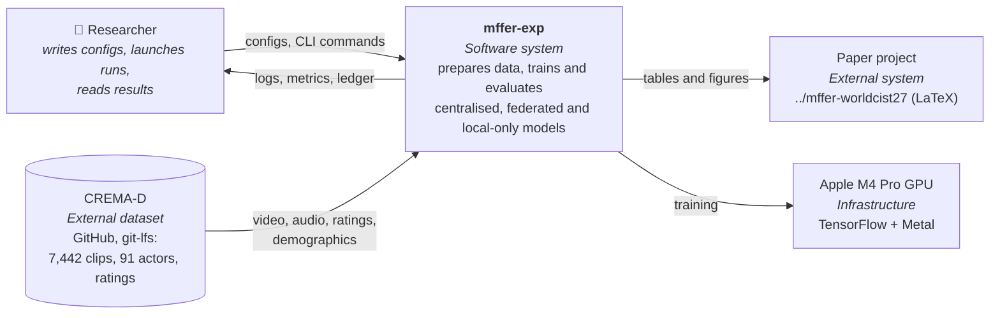
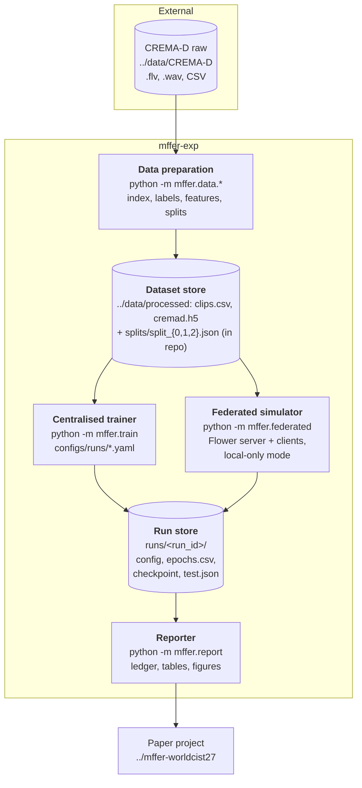
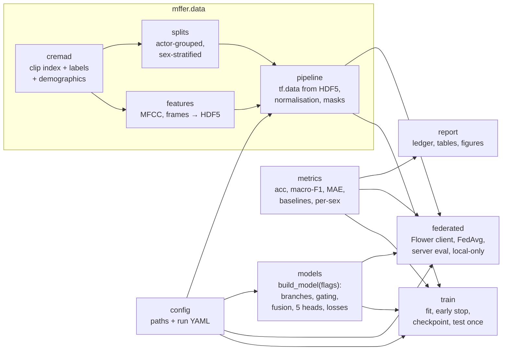

# mffer-exp — experiments for the WorldCIST'27 paper

Code for every experiment in the paper *Federated Multimodal Multi-Task Emotion Recognition for
Emotion-Aware Retail Assistants*. The paper's LaTeX lives next door in `../mffer-worldcist27/`; the
experiment plan is `../mffer-worldcist27/EXPERIMENT-PLAN.md`.

## Purpose

A retail kiosk assistant that reacts to a customer's emotional state must learn from face and voice data
that should stay on the kiosk. This repository trains and evaluates the emotion component of that
assistant:

- a **multi-task multimodal model** that predicts displayed emotion, perceived emotion, displayed valence
  and emotion intensity from audio (MFCCs), video frames and, optionally, text and demographics;
- trained **centrally** and with **federated learning** (Flower, FedAvg), and per client alone
  (local-only), on **CREMA-D**;
- under an **actor-independent protocol**: train, validation and test actors are disjoint; three
  different actor splits for mean ± sd; test is scored once, at the epoch (or round) chosen on validation.

Every number in the paper must be traceable to one run directory produced by this code.

Non-goals: the recommender, the chatbot and real kiosk deployment (architecture only in the paper);
privacy mechanisms beyond keeping raw data on the client (no differential privacy, no secure aggregation).

## Reproduce on a new machine

Needs conda, git and git-lfs, and ffmpeg (macOS: `brew install git-lfs ffmpeg`). About 20 GB of disk.

```bash
git clone https://github.com/n0th1ng999/mffer-exp.git
mkdir data && cd data                                         # sibling of mffer-exp (see configs/paths.yaml)
git lfs install
git clone https://github.com/CheyneyComputerScience/CREMA-D.git
git -C CREMA-D checkout 1658cd342dff90010aa843eaeebd53610a08b1dc   # the version used in the paper
cd ../mffer-exp
conda env create -f environment.yml        # macOS: TF 2.19 + Metal; Linux: TF 2.19 + CUDA; Windows: use WSL2
conda activate mffer
python scripts/smoke_test.py               # GPU visible, M1/M3 train a few steps, Flower runs 2 rounds
python -m mffer.data.cremad --summary      # checks the CREMA-D commit, builds clips.csv
python -m mffer.data.features              # MFCCs + 10 frames per clip -> cremad.h5 (~1–30 min, ~11 GB)
python -m pytest -q tests                  # invariants: splits, masks, normalisation, metrics
```

The actor splits are **not** regenerated: they are versioned in `splits/` and every machine uses the same
files (`python -m mffer.data.splits` refuses to overwrite them).

**What will and won't match.** Labels, masks, splits, features and seeds are identical on every machine.
Training on a GPU is not bit-for-bit deterministic (Metal and CUDA sum in different orders), so a rerun can
differ by a few tenths of a point per run; compare against the mean ± sd over the three splits, not single
runs. Times per epoch depend on the hardware recorded in each run's `meta.json`. Exact package versions of
the paper's runs: `requirements-macos-arm64.lock`.

## Everyday commands

```bash
conda activate mffer
python -m mffer.train configs/runs/c1_m1.yaml --split 0   # one centralised run (see Conventions)
python scripts/timing_pilot.py --preset m3                # time per step on this machine
python3 scripts/render_todo.py                            # refresh todo.html after editing TODO.md
```

Paths are set once in `configs/paths.yaml` (dataset at `../data/CREMA-D`, outputs in `runs/`).

## Repository layout

| Path | What | Status |
|---|---|---|
| `environment.yml` | Conda environment (macOS Metal / Linux CUDA) | done |
| `requirements-macos-arm64.lock` | Exact package versions of the paper's runs | done |
| `splits/` | The three frozen actor splits (versioned; never regenerated) | done |
| `configs/paths.yaml` | Dataset and output paths | done |
| `configs/runs/*.yaml` | One file per centralised configuration: C1, C2, U1, U2, D1–D4 | done (FL configs to do) |
| `mffer/config.py` | Load paths and run configs | done |
| `mffer/data/cremad.py` | Index CREMA-D: one row per clip with actor, sentence, labels, demographics | done (labels frozen 18 Nov) |
| `mffer/data/splits.py` | Actor-grouped, sex-stratified train/val/test splits, saved as JSON | done |
| `mffer/data/features.py` | MFCC and frame extraction → HDF5 | done |
| `mffer/data/pipeline.py` | `tf.data` input pipeline from HDF5 + split ([design](docs/pipeline-design.md)) | done |
| `tests/` | Invariant tests for splits and pipeline: `python -m pytest -q tests` | done |
| `scripts/timing_pilot.py` | Time per training step and per batch read on real data | done |
| `mffer/models.py` | Model builder: M1, M3 and the ladder variants from config flags | done |
| `mffer/train.py` | Centralised training, early stopping, checkpoints, resume, test once | written, not yet run |
| `mffer/federated.py` | Flower simulation (FL-IID, FL-non-IID) and local-only training | to do |
| `mffer/metrics.py` | Accuracy, macro-F1, MAE, per-sex breakdown, IEO intensity-ordering check, from `predictions.csv` | done |
| `mffer/report.py` | Results ledger, paper tables and figures from run directories | to do |
| `scripts/smoke_test.py` | Environment check on random tensors | done |
| `notebooks/eda.ipynb` | Exploratory analysis of CREMA-D: labels, masks, splits, baselines (kernel *Python (mffer)*) | done |
| `TODO.md`, `todo.html` | Task list (source) and its browser view; refresh with `python3 scripts/render_todo.py` | done |
| `runs/` | One directory per run (git-ignored) | — |

---

## Architecture (C4 model)

### Level 1 — System context

Who and what the experiment system talks to.



### Level 2 — Containers

The separately runnable parts and the data stores between them. Every container is a CLI entry point of
the same Python package; they communicate only through files, so each step can be rerun on its own.



| Container | Technology | Responsibility |
|---|---|---|
| Data preparation | Python, pandas, librosa, ffmpeg/OpenCV, h5py | Build the clip index and labels, extract MFCCs and 10 frames per clip, write frozen splits |
| Dataset store | HDF5 (uint8 frames, one clip per chunk), CSV, JSON | Single source of inputs and splits for every run |
| Centralised trainer | TensorFlow 2.19 / Keras, tensorflow-metal | Train one configuration on one split; early stopping on val; score test once |
| Federated simulator | Flower (`flwr`), same Keras model | FedAvg over N clients (IID or by actor); server evaluates the global model on val each round, test once; local-only baseline |
| Run store | Files | Everything needed to trace a number: config, split, seed, git hash, hardware, per-epoch CSV, test metrics |
| Reporter | pandas, matplotlib | Results ledger and the paper's tables/figures, generated only from the run store |

### Level 3 — Components (inside the `mffer` package)



| Component | Owns (invariant it guarantees) |
|---|---|
| `config` | One place for paths; a run is fully described by its YAML file |
| `data.cremad` | The definition of every label (displayed/perceived emotion, valence, intensities); one row per usable clip |
| `data.features` | Identical preprocessing for every run; frames stored as uint8, normalised only at read time |
| `data.splits` | No actor in more than one of train/val/test; splits are files, created once, never regenerated |
| `data.pipeline` | Normalisation statistics come from the train split only; missing-label masking (e.g. intensity on IEO only) |
| `models` | All configurations (M1, ladder steps, M3) come from one builder, so they differ only by declared flags |
| `train` | Same budget and stopping rule for every configuration; test is touched exactly once |
| `federated` | Same model and stopping rule as centralised; the global model is scored on the same test actors |
| `metrics` | Same metric code for all modes, including the baselines |
| `report` | Paper numbers come only from run directories |

### Level 4 — Code

Not drawn: the code is small enough to read. Entry points are the `main()` functions of the modules
above; the model graph is in `mffer/models.py` (`build_model`), and its M3 form matches Fig. 2 of the paper.

## Conventions

- **Run ID:** `<config>-s<split>-<yyyymmdd-hhmm>`, e.g. `c2_m3-s1-20261122-2310`.
- **Long runs:** `caffeinate -i python -m mffer.train configs/runs/c2_m3.yaml --split 1`. Each epoch is
  checkpointed, so a crash costs one epoch.
- **Nothing in the paper is typed by hand:** tables and figures come from `mffer.report`.
- **Anonymity:** no link to this repository in the submitted paper.

## Data decisions (frozen 18 Nov 2026)

| Item | Decision |
|---|---|
| Tasks | All five tasks of the draft: displayed emotion, perceived emotion, displayed valence, displayed intensity, perceived intensity |
| Displayed intensity | **Secondary task.** LO/MD/HI → 1/3, 2/3, 1. Only sentence IEO has levels, so it is trained and scored on those 1,365 clips only; other clips are masked for this head. Not verifiable on other sentences |
| Masked heads | Loss weight divided by the head's label coverage on the training rows, so configured weights hold |
| Perceived emotion | Majority of audio-visual ratings; 420 tied clips masked for this head only |
| Perceived intensity | Mean audio-visual rated intensity / 100 over all raters (`tabulatedVotes.csv`) |
| Valence | HAP positive, NEU neutral, others negative |
| Text | One-hot sentence ID (12 sentences) — same information as any sentence embedding |
| Demographics | Age (scaled) and sex |
| Audio | 13 MFCCs, 16 kHz, n_fft 1024, hop 40 ms, 100 frames = 4 s, zero-padded |
| Video | 10 uniformly spaced frames, centre square crop, 224×224 RGB uint8 |
| Splits | 3 actor-grouped, sex-stratified splits: 63 / 9 / 19 actors (train / val / test) |
