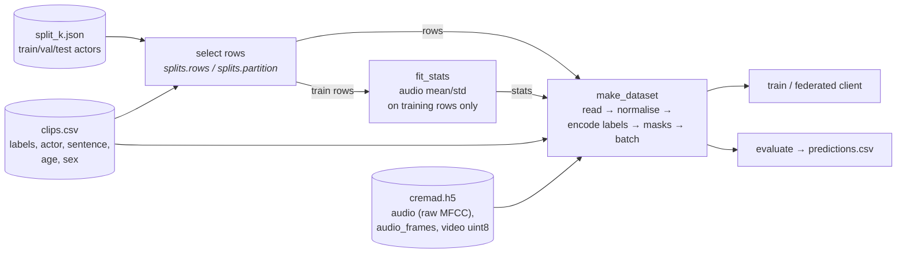

# Input pipeline: design (for review)

Module: `mffer/data/pipeline.py`. Status: **implemented 18 Nov**; invariants tested in `tests/test_pipeline.py`.

## Job

Turn "these clips, for this model configuration" into batches the Keras model can train or evaluate on:
`(inputs, targets, sample_weights)`. It is the only code that reads `cremad.h5` during training, and it is
shared by the centralised trainer, the federated clients, local-only training and the baselines.

## Where it sits



## Interface

```python
# mffer/data/splits.py (owner of "who gets which clips")
def rows(clips, split_id, part) -> np.ndarray                 # part: "train" | "val" | "test"
def partition(clips, train_rows, n_clients, mode, seed) -> list[np.ndarray]
    # mode "iid": clips dealt round-robin after a seeded shuffle (similar clients)
    # mode "actor": whole actors per client, sex-balanced (non-IID clients)

# mffer/data/pipeline.py
class Cremad:                                                   # opened once per process
    clips: pd.DataFrame                                         # clips.csv, row i == h5 row i (checked)
    h5: h5py.File

def fit_stats(data, train_rows) -> AudioStats                   # per-coefficient mean/std, 13 values each
def make_dataset(data, rows, spec, stats, *, training, seed=0, batch_size=16) -> tf.data.Dataset
```

`AudioStats` is saved as `audio_stats.json` in the run directory, so evaluation later uses exactly the
statistics the model was trained with.

## What one element looks like

**Inputs** (only those the `ModelSpec` uses):

| Key | Shape, dtype | Built from |
|---|---|---|
| `audio` | (100, 13) float32 | raw MFCC → `(x − mean) / std` per coefficient, then padded frames (beyond `audio_frames`) set back to 0 |
| `video` | (10, 224, 224, 3) float32 | uint8 / 255 |
| `text` (if `spec.text`) | (12,) float32 | one-hot of `sentence` |
| `demographics` (if `spec.demographics`) | (2,) float32 | `age / 100`, `sex` (female 0, male 1) |

**Targets and sample weights** (one per head in `spec.heads`):

| Head | Target | Weight 0 when |
|---|---|---|
| `displayed_emotion` | one-hot (6) | never |
| `perceived_emotion` | one-hot (6) | tied vote (420 clips) |
| `displayed_valence` | one-hot (3) | never |
| `displayed_intensity` | float in [0,1] | not sentence IEO with LO/MD/HI (6,077 clips) |
| `perceived_intensity` | float in [0,1] | never |

A masked target is filled with zeros. With weight 0 it adds nothing to the loss or to the Keras metrics.

## How data is read (performance)

- Each step needs 16 clips × 1.5 MB = 24 MB of video. The GPU needs about 0.45 s per M3 step, so reading
  must stay well under that.
- **Per epoch:** the training rows are shuffled in numpy with `seed + epoch`, then cut into batches of 16.
- **Per batch:** the 16 clips are read one by one (one HDF5 chunk each). A single multi-row `h5py` read was
  measured at 0.91 s per batch versus 0.011 s, so it is avoided. Audio (3.9 MB in total) is held in memory.

- It is wrapped in `tf.data` (`from_generator` over batches, then `map` for normalisation, then
  `prefetch(2)`), so reading the next batch overlaps the GPU step.
- Nothing is loaded into RAM up front. The training subset alone is about 7.9 GB, too much next to TF on
  24 GB unified memory. macOS file caching speeds up later epochs for free.
- Evaluation datasets are not shuffled and keep row order, so prediction i belongs to row i. `evaluate` then writes
  `predictions.csv` (one row per clip: targets, masks, predicted values). Every metric, including the
  per-sex breakdown, is computed from that file without rerunning the model.

## Invariants (checked in code)

1. `clips.csv` row i is `cremad.h5` row i (compares `clip_id` on open).
2. Rows in train, val and test come from disjoint actors (asserted when rows are selected).
3. Normalisation statistics come only from training rows: the run's training split, or the client's
   own data in federated runs (see open decision 1).
4. A masked target never contributes to a loss or metric (weight 0).
5. The same rows, seed and stats give the same batches.

Out of scope: data augmentation (none is used), loading raw audio/video (features are precomputed),
and per-run feature variants (one `cremad.h5` for everything).

## Decisions

Decided 18 Nov: 1 → (a), 2 → (b), 3 → (a). Displayed intensity is a secondary task, trained and scored on
IEO clips only (the only clips with a level); the paper's main intensity result is perceived intensity.

1. **Audio normalisation in federated runs.** Each client may only use its own data.
   - **(a) chosen:** each client normalises with its own statistics. Before training, the server
     combines the clients' 13 means and stds into one global set (a sample-weighted average), which the
     global model is evaluated with. Only 26 summary numbers per client are shared, never clips.
   - (b) Every client uses statistics from the whole training split. Simpler, but it assumes a central
     view of data that federated learning is meant to avoid.
2. **Loss scale of masked heads.** Keras averages each head's loss over the whole batch, zeros included.
   Displayed intensity exists on only about 18% of clips, so its effective weight is about 0.18 × its loss
   weight; perceived emotion loses only about 6%.
   - (a) *Recommended:* leave it as is and report the effective weights. Simple and transparent.
   - **(b) chosen:** divide each head's loss weight by the fraction of clips that carry it, so the configured weights
     mean what they say.
3. **Best-epoch criterion** (from the plan). **(a) chosen:** validation accuracy on displayed emotion.
   (b) Total validation loss.
